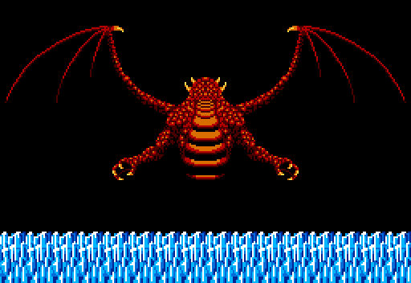
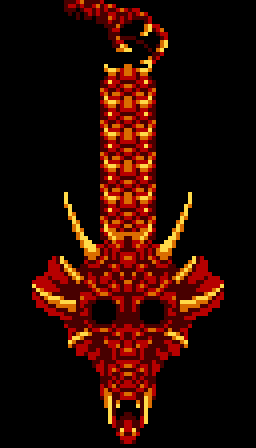
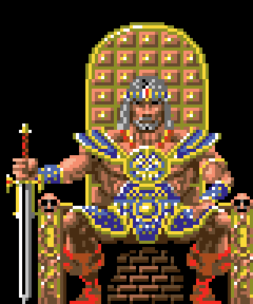

# Findings

## The dragon stage that gets skipped

Stage 0x11 has its record, its palette and its screen: a winged dragon over
the sea, with 130 tiles no other stage uses. `p00:5318` skips it: from 0x10
the game goes to 0x12. Built from the ROM.

The dragon's head: blocks 0x60-0x77 of stage 0x11's table, which its map does
not use.

## A test cheat in the header

Byte 0x4010 is 0. Set to 1, key 7 goes to the next stage, 6 to the previous
one and BS ends the game (`p00:5321`, `p00:5349`); in the attract sequence, 4
and 5 change the VRAM page on display (`p00:4E41`). Measured in openMSX on a
copy of the ROM with that byte set to 1.

## A throne with no layout

95 tiles in bank 0x19 make up a man sitting on a throne. There is no table
that lays them out and no routine found that draws them. The layout is the
one in The Cutting Room Floor's picture, checked tile by tile.

## An ending never drawn

The barbarian looking at the horizon, with blocks 0x2A-0x57 of the title's
table. The table is cut at 0x6000, at the end of bank 0, and the last two
rows of tiles fall outside it. No routine found draws it, and its blocks are
not read in the run through the 257 screens. The palette is not in the ROM:
it is The Cutting Room Floor's.

## Round 6 has no boss

The round comes from the stage (`p00:566C`: stage / 3 + 1). Round 6 gets
0x0F, 0x10 and 0x11, and 0x11 is the one that is skipped: two stages and no
boss room. 0x11 sits where that room would be and, like the five boss rooms,
is a single screen. Read in the code.

## The last byte of every 16 KB

The tiles go to VRAM 16 KB at a time with an LDIRVM of 0x3FFF bytes
(`p01:6077`): the last byte of each piece stays at 0. Checked against
openMSX's VRAM.

## The credits, as they are

CONGRATURATIONS, CHARACTOR and SPETIAL THANKS: that is how the ending text is
stored at `p04:8D6D`.

## Points never given

The bosses' points table has six words (`p07:9709`), but `p07:96DD` only lets
types 1 to 5 through: the sixth, 3000, is not read.

## Code that does not run

61 routines and pieces of code have no call or jump found: two that switch
the sound on and off (`p01:6478`), a palette fade (`p00:449B`), an HMMC copy
(`p00:4332`), hit boxes, another version of boss 5 (`p04:8A9A`)... None of
them runs in what was measured (see [In the emulator](IN-THE-EMULATOR.md)).
The listing keeps them with their code and that sentence, not as "unused".

Thanks to [The Cutting Room Floor](https://tcrf.net/) for the pictures of the
throne and the ending.
