# What the cartridge draws

Under each picture is where it comes from and what is on it.

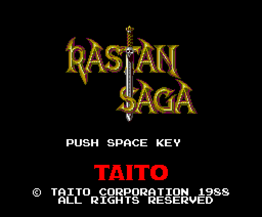

*The title screen, built from the ROM: it matches openMSX's VRAM byte for byte (<code>coteja_titulo.py</code>).*

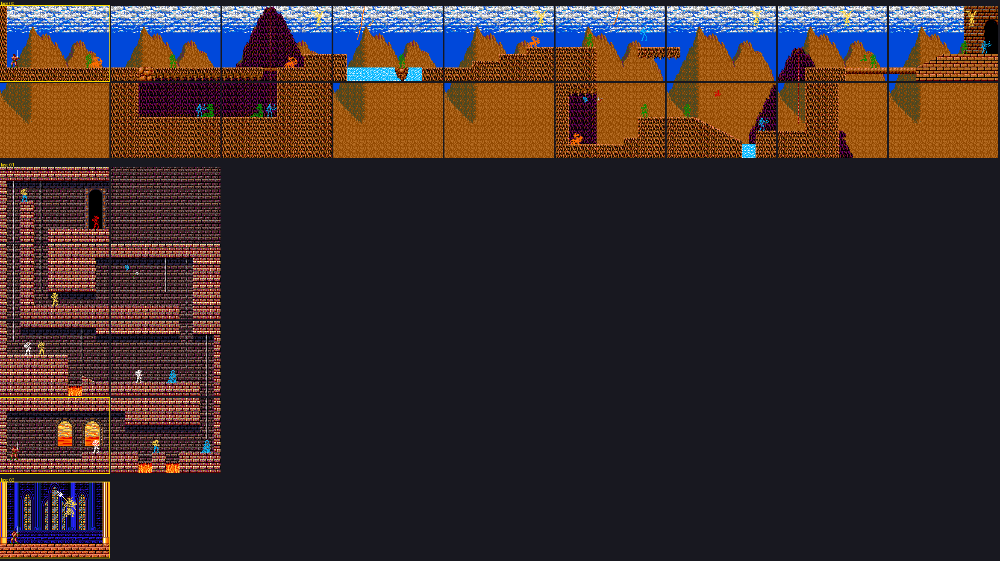

*Round 1: the outdoors, the castle and the boss room, with the enemies where they come out (<code>p00:58F9</code>), the boss where its routine puts it (<code>p04:8016</code>) and Rastan on the starting screen, framed.*

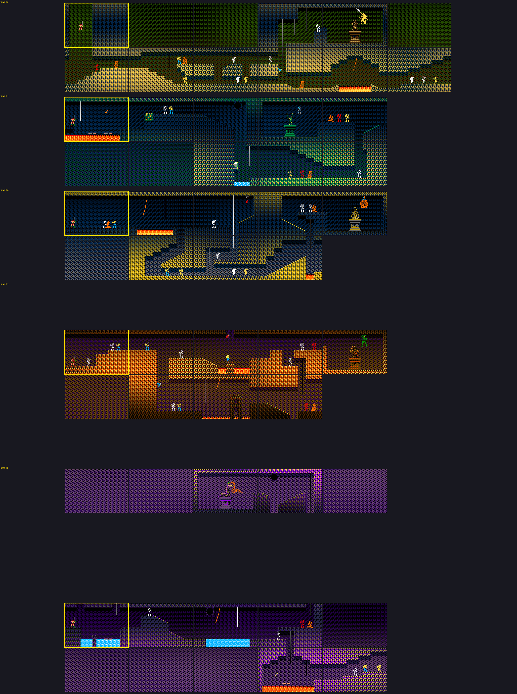

*Round 7: five stages that repeat the five bosses, each on a given screen (<code>p04:8BF4</code>).*

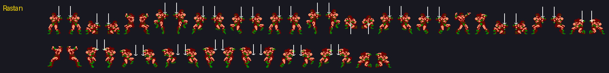

*Rastan: the 48 different combinations of his three layers (<code>p06:639F</code>, <code>p06:64B3</code> and the weapon) in his 92 poses, checked record by record against openMSX.*

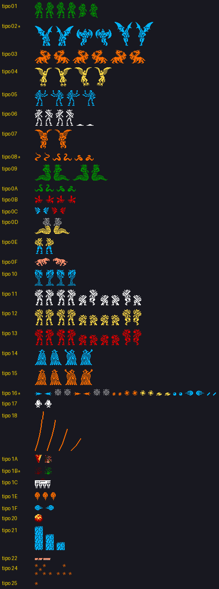

*The 37 actor types, one pose per figure (<code>p00:4C68</code>), with the palette of the first stage they appear in.*

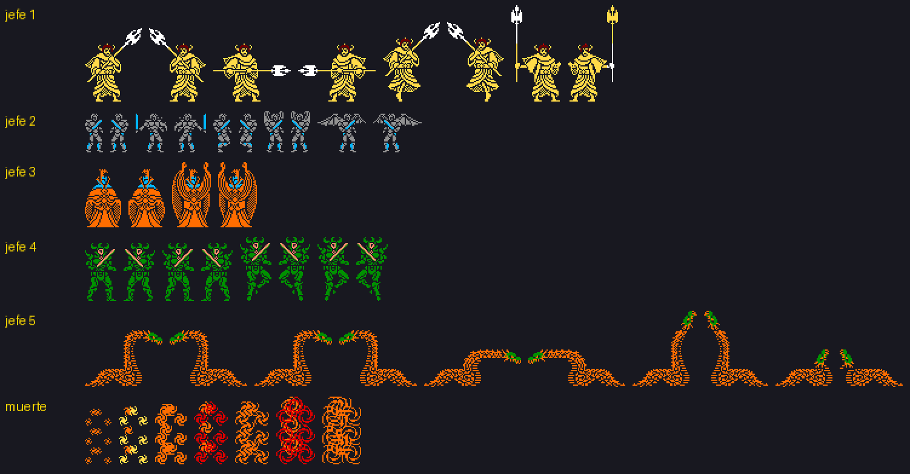

*The five bosses (<code>p03:7F76</code>, bank 8) and their death.*

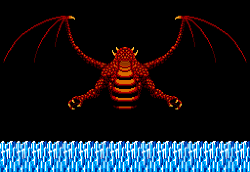

*Stage 0x11, the dragon's, which the game skips.*

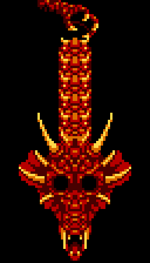

*The dragon's head: blocks 0x60-0x77 of stage 0x11's table, which its map does not use.*

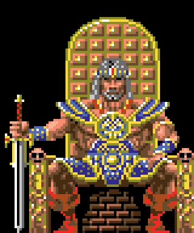

*The throne: 95 tiles with no table, laid out as in The Cutting Room Floor's picture.*

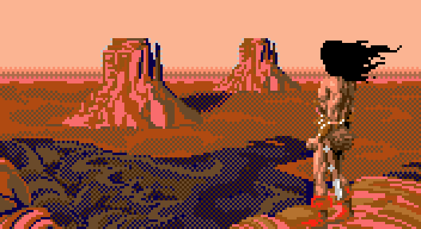

*The ending: the barbarian looking at the horizon.*

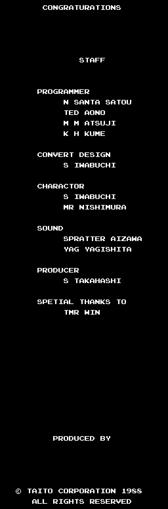

*The ending text (<code>p04:8D01</code>) in the cartridge's own font.*
