# El juego

Rastan recorre siete rondas. Cada fase es una rejilla de pantallas de 256 ×
176 puntos, 11 filas de 16 bloques de 16 × 16, y se pasa de una a otra
saliendo por un borde (`p00:5367`).

## La pantalla de título

Siete filas de nueve bloques (`p00:5189`) con su paleta (`p00:5207`), el
rótulo de Taito (`p00:5227`) y dos líneas de texto con la fuente del juego.

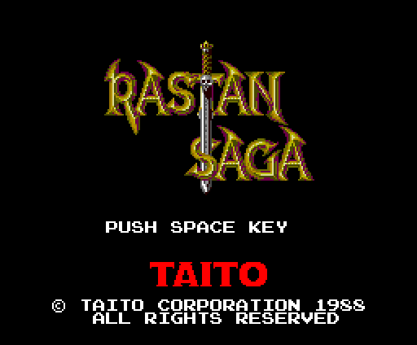

## Las rondas

Hay 24 fichas de fase de 16 bytes (`p02:9035`): la tabla de pantallas, la de
bloques, el tamaño, la pantalla de salida, los dos fondos, la paleta, el
banco de los mapas y dónde aparece Rastan. La ronda sale de la fase
(`p00:566C`):

| ronda | fases | qué hay |
|---|---|---|
| 1-5 | tres cada una | el exterior, el castillo y la sala del jefe |
| 6 | 0x0F, 0x10 | dos fases y ningún jefe: la 0x11 se salta |
| 7 | 0x12-0x16 | cinco fases que repiten los cinco jefes |

La 0x17 es el final. En total, 257 pantallas; 255 en las 22 fases que se
juegan.

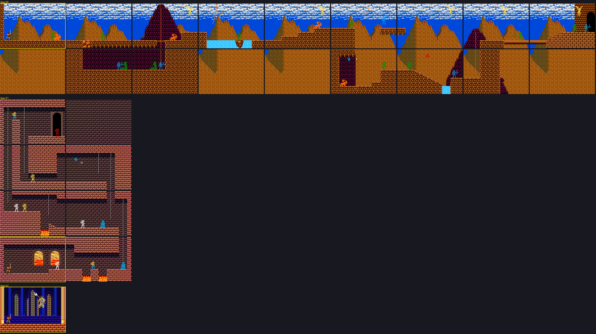

La ronda 1: el exterior, el castillo y la sala del jefe, con los enemigos
donde salen (`p00:58F9`), el jefe donde lo pone su rutina (`p04:8016`) y
Rastan en la pantalla de salida, recuadrada.

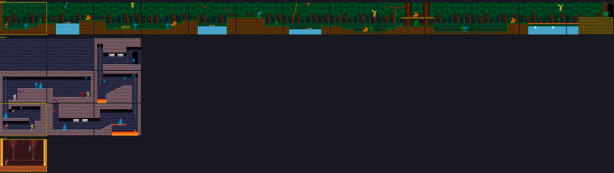

La ronda 2: fases 0x03, 0x04 y 0x05.

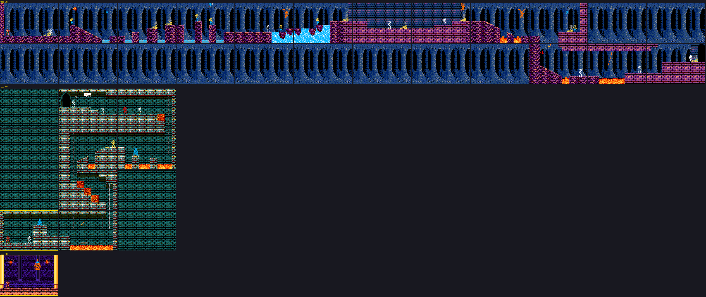

La ronda 3: fases 0x06, 0x07 y 0x08.

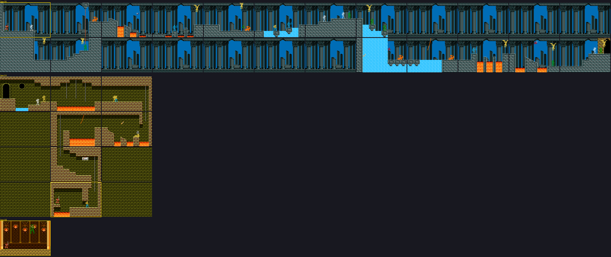

La ronda 4: fases 0x09, 0x0A y 0x0B.

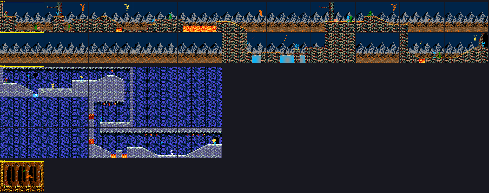

La ronda 5: fases 0x0C, 0x0D y 0x0E.

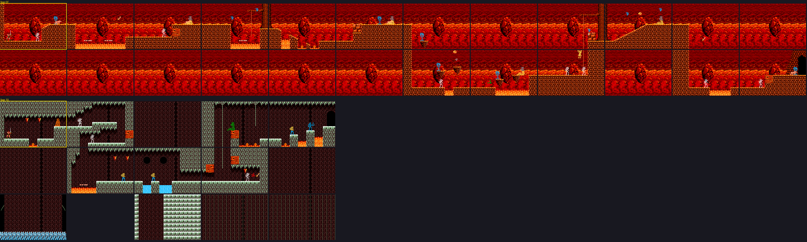

La ronda 6: fases 0x0F y 0x10.

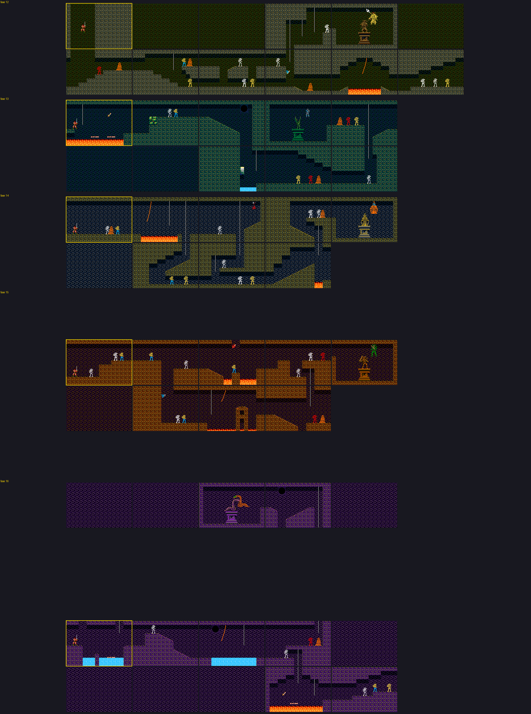

La ronda 7: cinco fases que repiten los cinco jefes, cada uno en una pantalla
concreta (`p04:8BF4`).

## Una pantalla

Un fondo opaco para la fila de arriba y otro para las demás, la lista de
bloques de delante, las columnas que se alargan hacia abajo (`p00:55C5`) y,
al final, los actores: hasta 8 enemigos, 3 objetos y un bloque especial
(`p00:58F9`). Las listas van empaquetadas: 0xD0 repite un bloque, EF EF acaba.

## Rastan

Tres capas de sprites (`p06:6134`): el cuerpo (`p06:639F`), la segunda capa
(`p06:64B3`) y el arma, que sale de una de cuatro tablas (`p06:6397`) según lo
que lleve. En sus 92 poses hay 48 combinaciones distintas.

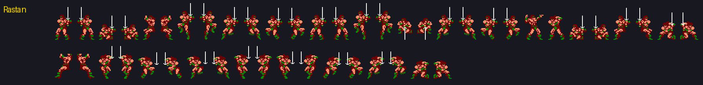

## Los actores

37 tipos (`p00:4C68`), cada uno con su lista de poses; las definiciones de los
tipos 0x01-0x17 están en el banco 30 y las de los demás en el 26. Un enemigo
de la lista de la pantalla es un código que `p00:57D3` convierte en tipo y
pose; con el bit 7, es un trozo de decorado animado.

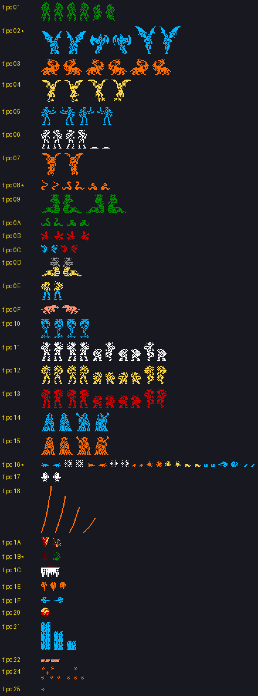

## Los jefes

Las salas de jefe no traen actores: el jefe lo da de alta su rutina en p04
(`p04:8016`, `8262`, `848E`, `8799` y `89CE`), tipos 1 a 5, con sus poses en
`p03:7F76` y sus dibujos en el banco 8, y una vida de 320, 320, 160, 320 y
400 (medido). Al morir pasa al tipo 7, la muerte (`p03:7FDA`), y suma sus
puntos: 500, 1000, 1500, 2000 y 2500 (`p07:9709`). En la ronda 7, cada uno
sale en una pantalla concreta (`p04:8BF4`-`8C4B`).

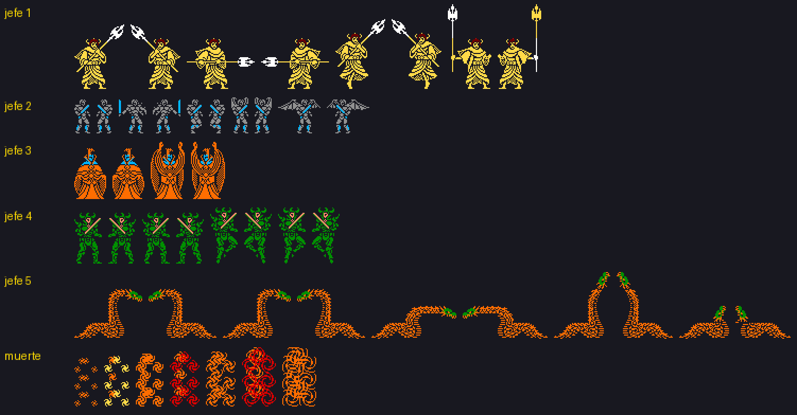

## El final

La fase 0x17: la música 5, la pantalla a 0 y el texto de `p04:8D01` subiendo
línea a línea; después, el rótulo de Taito y el juego se queda ahí.

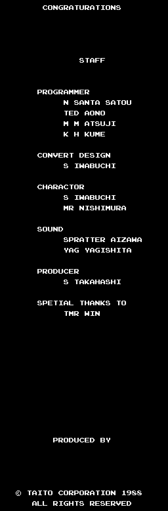
