# Lo que el cartucho dibuja

Debajo de cada imagen está de dónde sale y qué se está viendo.

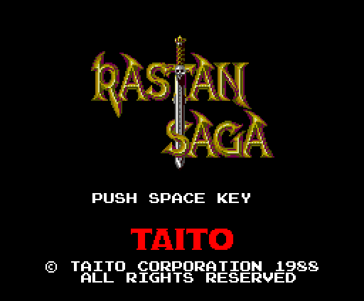

*La pantalla de t&iacute;tulo, montada desde la ROM: coincide con la VRAM de openMSX byte a byte (<code>coteja_titulo.py</code>).*

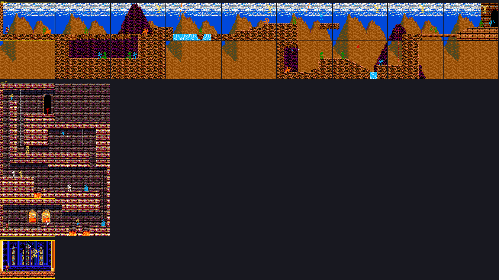

*La ronda 1: el exterior, el castillo y la sala del jefe, con los enemigos donde salen (<code>p00:58F9</code>), el jefe donde lo pone su rutina (<code>p04:8016</code>) y Rastan en la pantalla de salida, recuadrada.*

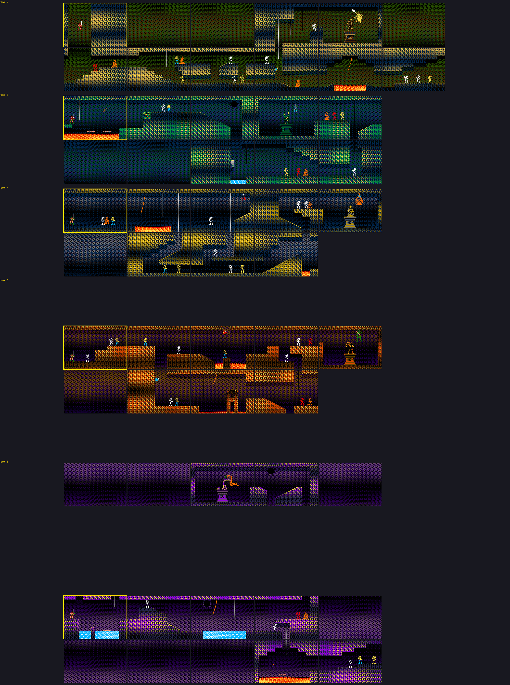

*La ronda 7: cinco fases que repiten los cinco jefes, cada uno en una pantalla concreta (<code>p04:8BF4</code>).*

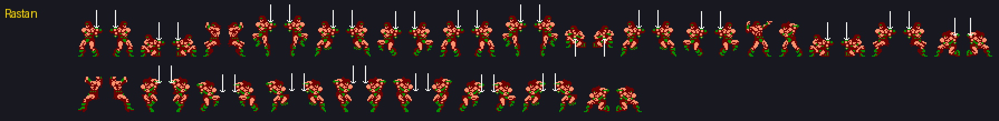

*Rastan: las 48 combinaciones distintas de sus tres capas (<code>p06:639F</code>, <code>p06:64B3</code> y el arma) en sus 92 poses, cotejadas ficha a ficha contra openMSX.*

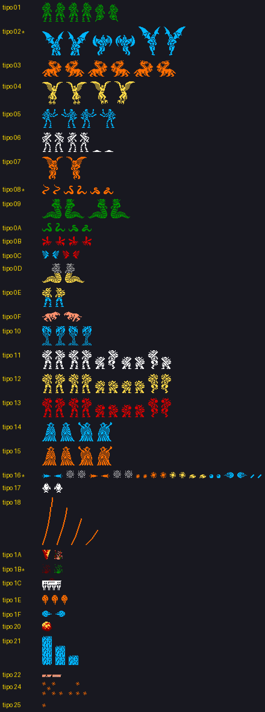

*Los 37 tipos de actor, una pose por figura (<code>p00:4C68</code>), con la paleta de la primera fase en que salen.*

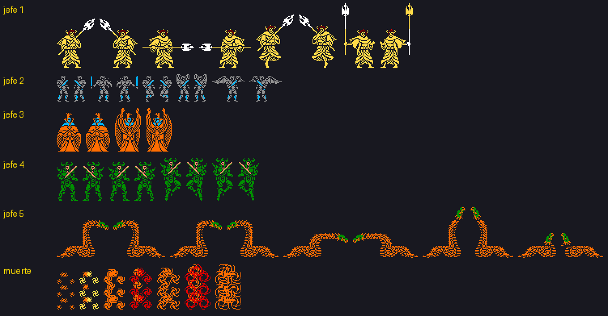

*Los cinco jefes (<code>p03:7F76</code>, banco 8) y la muerte.*

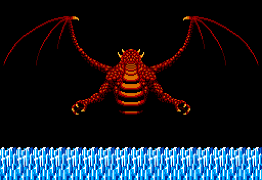

*La fase 0x11, la del drag&oacute;n, que el juego se salta.*

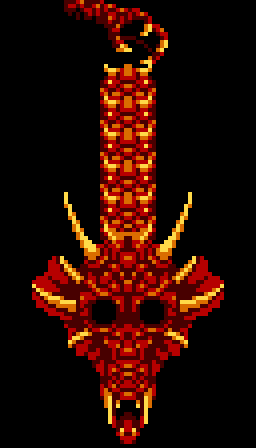

*La cabeza del drag&oacute;n: bloques 0x60-0x77 de la tabla de la fase 0x11, que su mapa no usa.*

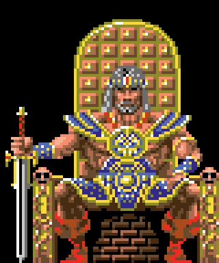

*El trono: 95 tiles sin tabla, colocados como en la l&aacute;mina de The Cutting Room Floor.*

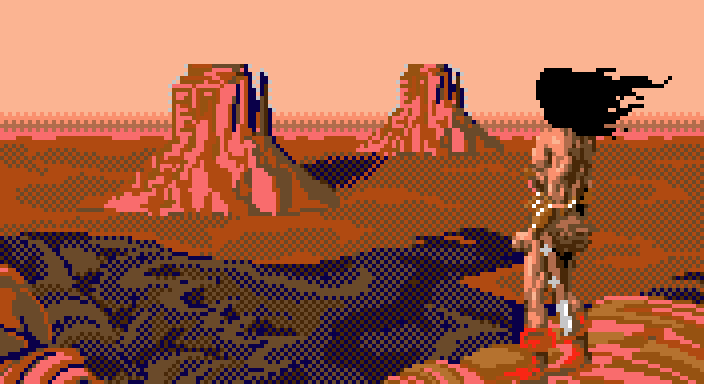

*El final: el b&aacute;rbaro mirando al horizonte.*

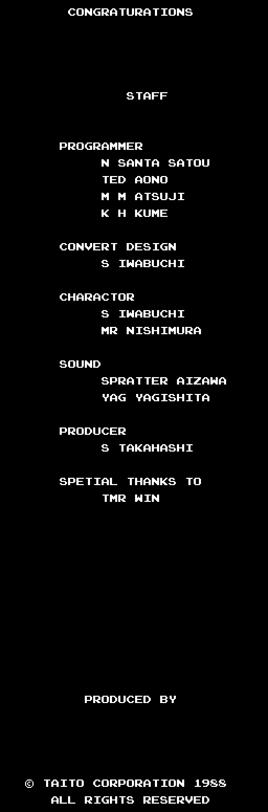

*El texto del final (<code>p04:8D01</code>) con la fuente del cartucho.*
